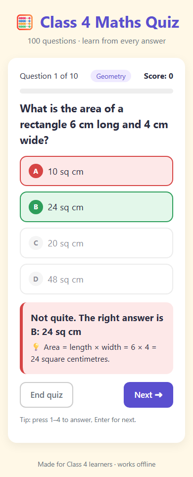

# 🧮 Class 4 Maths Quiz

An interactive multiple-choice quiz with **100 questions** for Class 4 (Grade 4) maths.
After every answer the learner sees whether it was **right or wrong** and an **explanation**.
Many wrong options also come with a note on **why that answer is a common mistake**.



## Topics (100 questions)

| Topic | Qs | Topic | Qs |
|---|---|---|---|
| Numbers & Place Value | 14 | Fractions | 11 |
| Addition | 8 | Decimals & Money (₹) | 8 |
| Subtraction | 8 | Time | 8 |
| Multiplication | 10 | Measurement | 7 |
| Division | 9 | Geometry | 7 |
| Factors & Multiples | 6 | Patterns & Data | 4 |

## Features

- **Choose topics, then pick a quiz length.** Select one or more topics, then play all of their questions or a **Quick 10**. Questions are shuffled every time.
- **Instant feedback.**
  - The correct answer turns green and a wrong choice turns red.
  - An explanation is always shown.
  - Many wrong choices also get a "why this is wrong" note.
- **Score and progress.** A progress bar and running score are shown, and the best score is saved in the browser.
- **Results screen.** Shows a per-topic breakdown, a review of every mistake, and a **Retry wrong answers** button.
- **Keyboard support.** Press keys `1`–`4` to answer and `Enter` to go to the next question.
- **Mobile-friendly and offline.** It is plain HTML/CSS/JS with no server or internet needed.

## Run it

Double-click `index.html`; it opens in any browser.

## Publish free on GitHub Pages (share a link with anyone)

1. Create a **public** repository on GitHub, e.g. `grade4-maths-quiz`, and push this folder:
   ```
   git remote add origin https://github.com/<your-user>/grade4-maths-quiz.git
   git push -u origin main
   ```
2. On GitHub, open the repository, then go to **Settings → Pages**.
3. Under **Build and deployment**, set **Source: Deploy from a branch**, **Branch: `main`**, and folder **`/ (root)`**, then click **Save**.
4. After about a minute the site is live at `https://<your-user>.github.io/grade4-maths-quiz/`. Anyone can open it on a phone or computer.

## Editing questions

Questions live in `tools/build_questions.py`. Answers are computed in Python, and every question is checked to have 4 different options. After editing, regenerate the questions file:

```
python tools/build_questions.py      # regenerates questions.js
python -m pytest -q                  # validates data + browser tests (uses installed Edge)
```

The browser tests need `pip install pytest playwright`. They use the installed Microsoft Edge, so no browser download is needed. If Edge is missing, the browser tests are skipped.
